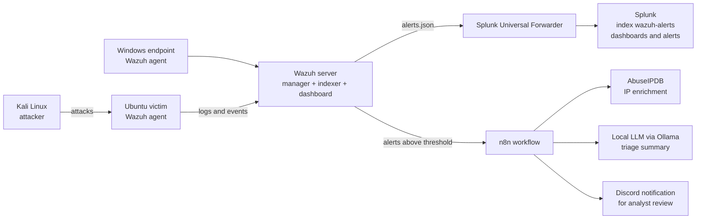

# Ai-Assisted-SIEM
# Wazuh SIEM Home Lab: Attack Detection, Splunk Dashboards and AI-Assisted Triage


A virtual SOC lab built to practise the daily work of a junior security analyst: collecting logs, detecting attacks, triaging alerts (true positive vs. false positive), investigating, and documenting incidents. Everything runs on my own machines. All attacks are launched only against my own virtual machines, on an isolated network.

## Objectives

1. Deploy a Wazuh SIEM/XDR and onboard Linux and Windows endpoints.
2. Simulate common attacks and check whether they are detected, and with which rule.
3. Write detection logic (a custom Wazuh rule) and map alerts to MITRE ATT&CK.
4. Forward Wazuh alerts to Splunk for search, dashboards and scheduled alerting.
5. Add an AI-assisted triage step that summarises each alert and suggests a priority, with a human making the final decision.
6. Measure the results honestly: detections, misses and false positives.

## Architecture



| Component | Role |
|---|---|
| Wazuh server | Collects and analyses events, raises alerts, runs active response |
| Ubuntu victim (agent) | Monitored Linux endpoint; SSH target |
| Windows endpoint (agent) | Monitored Windows endpoint (file integrity monitoring) |
| Kali Linux | Attacker machine (lab only) |
| Splunk | Search, dashboards, scheduled alerts on Wazuh data |
| n8n + Ollama | Alert enrichment and AI-assisted triage, human in the loop |

## Roadmap and progress

- [ ] **Phase 1:** Lab network and Wazuh deployment, agents onboarded
- [ ] **Phase 2:** Attack simulations (SSH brute force, file tampering, network scan) and detection review
- [ ] **Phase 3:** Custom detection rule, MITRE ATT&CK mapping, active response
- [ ] **Phase 4:** Splunk integration, dashboard and scheduled alert
- [ ] **Phase 5:** AI-assisted triage pipeline (n8n, AbuseIPDB, Ollama)
- [ ] **Phase 6:** Evaluation (detection table, false positives) and lessons learned
- [ ] *(Optional)* **Phase 7:** Isolation Forest anomaly detection on exported alerts, compared with rule-based detection

## Repository structure

```
.
├── README.md
├── docs/
│   ├── architecture.md          # network layout, VM sizing, versions
│   ├── setup/                   # step-by-step setup notes per phase
│   └── screenshots/             # redacted screenshots only
├── detections/
│   └── local_rules.xml          # custom Wazuh rules
├── incident-reports/            # one report per simulated attack
├── splunk/
│   ├── inputs.conf              # forwarder configuration (no secrets)
│   └── searches.md              # SPL queries and dashboard description
├── ai-triage/
│   ├── n8n-workflow.json        # exported workflow with placeholders
│   ├── prompt-template.md       # triage prompt
│   └── evaluation.md            # how often the AI summary was right or wrong
└── ml/                          # optional Isolation Forest experiment
```

## Results

Filled in after each phase.

| Attack simulated | Technique (MITRE ATT&CK) | Detected? | Wazuh rule | Time to alert | Notes |
|---|---|---|---|---|---|
| | | | | | |


## Security and ethics

- All attack traffic stays on an isolated virtual network between my own VMs.
- No real credentials, API keys, webhook URLs or personal data are committed. Configuration files use placeholders.
- AI output is advisory only: every alert is reviewed by a human before any action.

## References and credits

- [Wazuh documentation](https://documentation.wazuh.com/)
- [Wazuh blog: Extending Wazuh detection with Splunk integration](https://wazuh.com/blog/detection-with-splunk-integration/)
- [KellyCalvin23/SOC-Automation](https://github.com/KellyCalvin23/SOC-Automation): reference for the Wazuh to n8n to Ollama triage pattern. My implementation is built and documented separately.
- [Add any other tutorial, video or article you follow]

## Author

Roua Jendoubi: ICT graduate (networks, security, applied AI). [GitHub](https://github.com/roua-24)

## License

MIT LICENSE.
